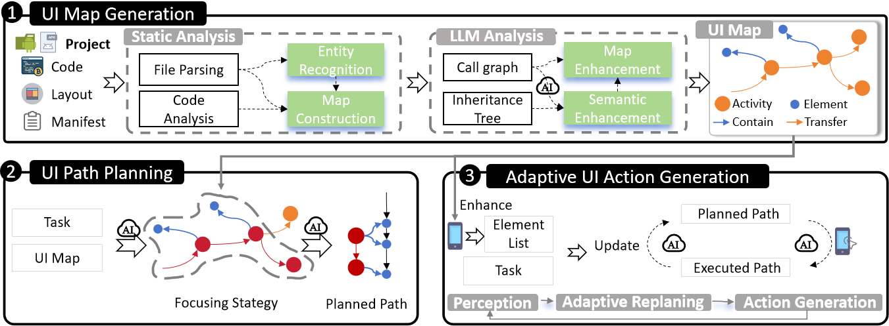
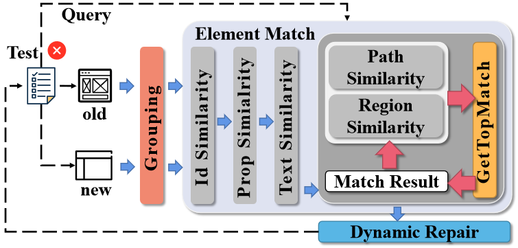

I am a PhD candidate at Beihang University, advised by [Xiang Gao](https://gaoxiang9430.github.io/index.html) , and a member of the SDP Group co-advised by [Hailong Sun](https://hsun2022.github.io/) and [Xiang Gao](https://gaoxiang9430.github.io/index.html). Previously, I received my Master's degree from Southern University of Science and Technology, advised by [Shin Hwei Tan](https://www.shinhwei.com/) , and my Bachelor's degree from Xidian University.

My research interests include:
- GUI Agent & Mobile Task Automation
- AI-powered Software GUI Testing & GUI Test Repair
- Program Analysis for GUI Applications

# 🔥 News
- *2025*: &nbsp;🎉🎉 Our paper **"UICOMPASS: UI Map Guided Mobile Task Automation via Adaptive Action Generation"** has been accepted by the EMNLP'25 research papers track (Main conference). 
- *2023.08*: &nbsp;🎉🎉 Our paper **"Automated Fixing of Web UI Tests via Iterative Element Matching"** has been accepted by the ASE'23 research papers track. 

# 📝 Publications 

<!--EMNLP2025-->

EMNLP 2025

<h3><strong>UICOMPASS: UI Map Guided Mobile Task Automation via Adaptive Action Generation</strong></h3>

**Yuanzhang Lin**, Zhe Zhang, Rui He, Qingao Dong, Mingyi Zhou, Jing Zhang, Xiang Gao*, Hailong Sun*

- Web UI test cases are employed to Mobile task automation is an emerging technology that leverages AI to automatically execute routine tasks by users' commands on mobile devices like Android, thus enhancing efficiency and productivity. 
While large language models (LLMs) excel at general mobile tasks through training on massive datasets, they struggle with app-specific workflows. 
To solve this problem, we designed UI Map, a structured representation of target app's UI information...
<!-- We further propose a UI Map-guided LLM-based approach UICOMPASS to automate mobile tasks.
Specifically, UICOMPASS first leverages static analysis and LLMs to automatically build UI Map from either source codes of apps or byte codes (\emph{i.e.,} APK packages).
During task execution, UICOMPASS mines the task-relevant information from UI Map to feed into the LLMs, generates a planned path, and adaptively adjusts the path based on the actual app state and action history.
Experimental results demonstrate that UICOMPASS achieves a 15.87\% higher task executing success rate than SOTA approaches.
Even when only APK is available, UICOMPASS maintains superior performance, demonstrating its applicability to closed-source apps. -->

<!--ASE23-->

ASE 2023

<h3><strong>Automated Fixing of Web UI Tests via Iterative Element Matching</strong></h3>

**Yuanzhang Lin**, Guoyao Wen, Xiang Gao*

- Web UI test cases are employed to automatically test web applications. 
<!-- - When a web application undergoes updates, these UI tests need to be updated as well to perform regression testing on the new version of the web application.  --> However, keeping UI tests up-to-date can be a tedious and time-consuming task due to the rapid evolution of web applications. Consequently, there has been increasing attention on automatically repairing web UI tests to address these challenges. To address these issues, we propose UITESTFIX, an approach based on a novel iterative matching algorithm aimed at improving the accuracy of UI element matching. 
<!-- UITESTFIX is designed based on two main insights: (1) the relations between different elements can provide guidance in the matching process, and (2) the results of previous iterations can inform the matching process in the current iteration.  -->
<!-- Our evaluation using publicly available datasets and two industrial apps demonstrates that UITESTFIX outperforms four existing approaches by achieving more accurate element matching and producing more correct fixes. -->

<!-- - [Lorem ipsum dolor sit amet, consectetur adipiscing elit. Vivamus ornare aliquet ipsum, ac tempus justo dapibus sit amet](https://github.com), A, B, C, **CVPR 2020** -->

<!-- # 🎖 Honors and Awards -->
<!-- - *2021.10* Lorem ipsum dolor sit amet, consectetur adipiscing elit. Vivamus ornare aliquet ipsum, ac tempus justo dapibus sit amet.  -->
<!-- - *2021.09* Lorem ipsum dolor sit amet, consectetur adipiscing elit. Vivamus ornare aliquet ipsum, ac tempus justo dapibus sit amet.  -->

<!-- # 📖 Educations -->
<!-- - *2019.06 - 2022.04 (now)*, Lorem ipsum dolor sit amet, consectetur adipiscing elit. Vivamus ornare aliquet ipsum, ac tempus justo dapibus sit amet.  -->
<!-- - *2015.09 - 2019.06*, Lorem ipsum dolor sit amet, consectetur adipiscing elit. Vivamus ornare aliquet ipsum, ac tempus justo dapibus sit amet.  -->

<!-- # 💬 Invited Talks -->
<!-- - *2021.06*, Lorem ipsum dolor sit amet, consectetur adipiscing elit. Vivamus ornare aliquet ipsum, ac tempus justo dapibus sit amet.  -->

### Co-authored Papers

- **Reference-Based Retrieval-Augmented Unit Test Generation**  
  Zhe Zhang, Xingyu Liu, **Yuanzhang Lin**, Xiang Gao#, Hailong Sun#, Yuan, Yuan, *TOSEM 2025* (CCF A)

- **Enhanced Automated Vulnerability Repair through Dependency Embedding and Pattern Store**  
  Qingao Dong, **Yuanzhang Lin**, Hailong Sun, Xiang Gao#
, *SANER 2025* (CCF B)

- **Enhanced Vulnerability Localization: Harmonizing Task-Enhanced Tuning and General LLM Prompting**  
  Wentong Tian, **Yuanzhang Lin**, Xiang Gao#, Hailong Sun#
, *ICSME 2025* (CCF B)

## 💻 Internships

  

    
  

  

### Hithink RoyalFlush Information Network Co., Ltd. - GUI Agent & LLM Post-training

*2026.05 – Present \| Industry–University Collaboration*

Research on knowledge-enhanced GUI agents for mobile testing, and infrastructure for agentic model post-training and benchmark evaluation.

  

  

    
      
      
    
  

  

### Huawei Technologies Co., Ltd. - Automated Repair of GUI Tests

*2021.07 – 2023.05 \| Dongguan, China*

  

